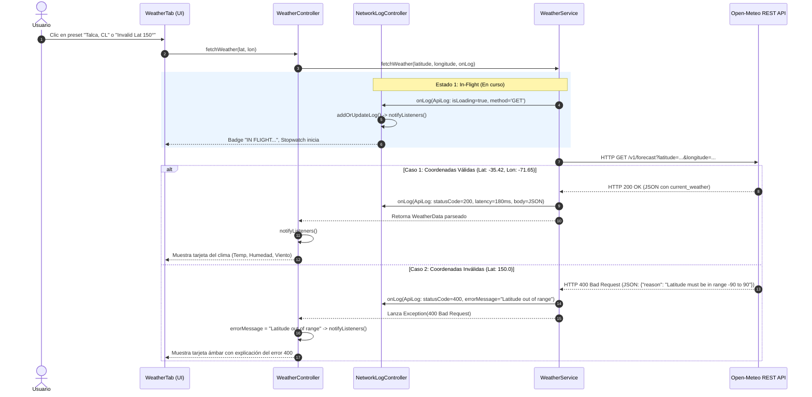
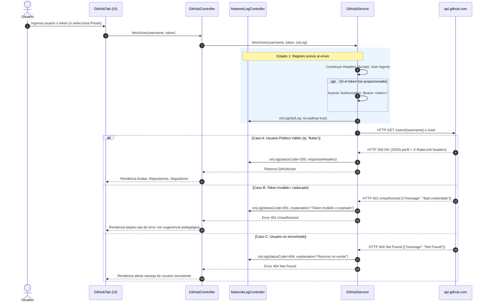
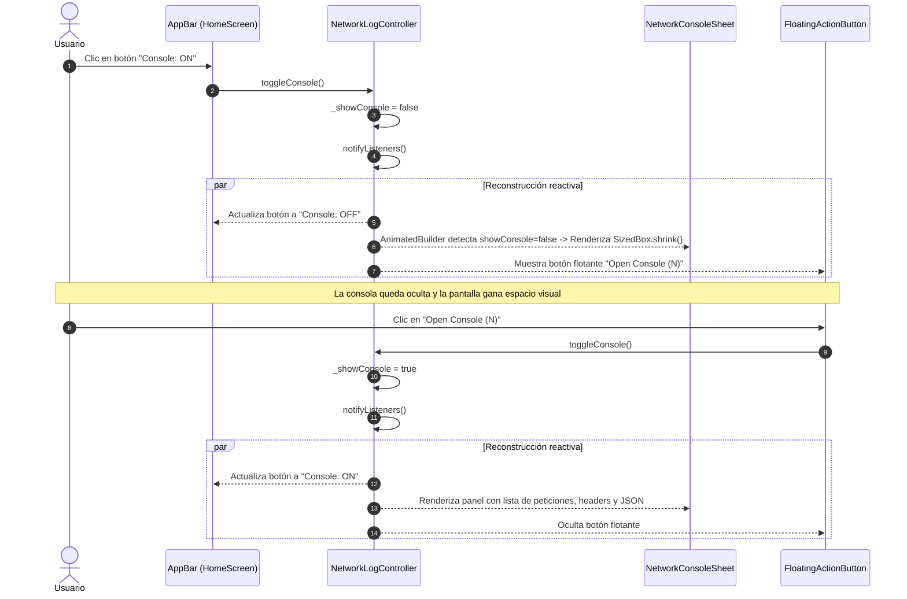

# PoC de Solicitudes y Ciclo de Vida REST API en Flutter (`flutter_poc_apirest_request`)

Prueba de Concepto (PoC) interactiva que demuestra el ciclo de vida completo de solicitudes HTTP en Flutter utilizando el paquete oficial `package:http`, gestión reactiva nativa con `ChangeNotifier` y una **Consola / Inspector de Diagnóstico de Red en Vivo** desplegable.

---

## Tabla de Contenidos
1. [APIs REST Implementadas](#-apis-rest-implementadas)
2. [Arquitectura y Estructura del Proyecto](#-arquitectura-y-estructura-del-proyecto)
3. [Preguntas Clave de Arquitectura y Decisiones de Diseño](#-preguntas-clave-de-arquitectura-y-decisiones-de-diseño)
   * [¿Por qué no usamos `Provider` o `MultiProvider` en `main.dart`?](#1-por-qué-no-se-utilizó-provider-o-multiprovider-en-maindart)
   * [¿Por qué la carpeta se llama `state/` y no `viewmodels/`?](#2-por-qué-la-carpeta-se-llama-state-y-no-viewmodels)
   * [Explicación de Widgets Principales de UI](#3-explicación-de-los-widgets-principales-de-ui)
4. [Diagramas de Secuencia y Flujos de Trabajo (Mermaid)](#-diagramas-de-secuencia-y-flujos-de-trabajo)
   * [Flujo 1: Petición sin autenticación (Open-Meteo - 200 OK y 400 Bad Request)](#flujo-1-open-meteo-sin-autenticación)
   * [Flujo 2: Petición con / sin token Bearer (GitHub API - 200, 401 y 404)](#flujo-2-github-api-autenticado-y-público)
   * [Flujo 3: Ciclo de Notificación y Consola de Diagnóstico (Toggle ON/OFF)](#flujo-3-ciclo-de-notificación-reactiva-y-consola-de-red)
5. [Instrucciones de Ejecución y Pruebas](#-instrucciones-de-ejecución-y-pruebas)

---

## APIs REST Implementadas

| API | Autenticación | Endpoints Utilizados | Códigos HTTP Demostrados |
|---|---|---|---|
| **[Open-Meteo](https://open-meteo.com/)** | **Ninguna** (Acceso libre inmediato) | `GET /v1/forecast?latitude=...&longitude=...` | **`200 OK`**: Pronóstico climático válido (Talca, Tokio)<br>**`400 Bad Request`**: Parámetros fuera de rango (Lat > 90°) |
| **[GitHub REST API](https://docs.github.com/en/rest)** | **Híbrida** (Pública o con Bearer Token) | `GET /users/{username}`<br>`GET /user` | **`200 OK`**: Perfil público (`flutter`, `torvalds`)<br>**`401 Unauthorized`**: Token Bearer inválido enviado a `/user`<br>**`404 Not Found`**: Usuario inexistente<br>**`403 Forbidden`**: Límite de tasa (`X-RateLimit-Remaining`) |

---

## Arquitectura y Estructura del Proyecto

El código aplica una arquitectura limpia desacoplada por capas:

```
lib/
├── main.dart                       # Punto de entrada con Material 3 (temas claro y oscuro)
├── models/
│   ├── api_log.dart                # Modelo de auditoría de red, latencia y explicación pedagógica
│   ├── github_user.dart            # Modelo de dominio para usuarios de GitHub
│   └── weather_data.dart           # Modelo de dominio para clima de Open-Meteo
├── services/
│   ├── github_service.dart         # Cliente HTTP para GitHub (manejo de cabeceras y Bearer token)
│   └── weather_service.dart        # Cliente HTTP para Open-Meteo (medición de Stopwatch y timeouts)
├── state/                          # Capa de estado y controladores (ChangeNotifier)
│   ├── github_controller.dart      # Controlador de estado para GitHub y presets de simulación
│   ├── network_log_controller.dart # Controlador del historial de red y visibilidad de la consola
│   └── weather_controller.dart     # Controlador de estado para Open-Meteo y presets
└── views/
    ├── home_screen.dart            # Pantalla principal con TabBar y botón toggle de consola
    ├── tabs/
    │   ├── github_tab.dart         # Vista de prueba de GitHub (inputs, presets y tarjeta)
    │   └── weather_tab.dart        # Vista de clima (coordenadas, presets y tarjeta)
    └── widgets/
        ├── json_viewer.dart        # Visor de JSON con formato monospace y botón de copiado
        ├── network_console_sheet.dart # Inspector inferior con headers, latencia y estado
        └── status_badge.dart       # Badge visual con semántica accesible y colores según status
```

---

## Preguntas Clave de Arquitectura y Decisiones de Diseño

### 1. ¿Por qué no se utilizó `Provider` o `MultiProvider` en `main.dart`?

Existen tres razones técnicas de peso:

1. **Sin dependencias externas innecesarias:**
   `ChangeNotifier` es una clase nativa del SDK de Flutter (en `package:flutter/foundation.dart`). No es necesario agregar la dependencia `provider: ^6.x` para tener reactividad limpia.
2. **Ciclo de vida y prevención de fugas de memoria (*Memory Leaks*):**
   Envolver `main.dart` con `MultiProvider` crea instancias que permanecen en memoria como *singletons* durante toda la vida de la app. En nuestra solución, [`HomeScreen`](file:///Users/manuel/Documents/flutter_projects/3479A321_202602/flutter_poc_apirest_request/lib/views/home_screen.dart) es un `StatefulWidget` que inicializa los controladores en `initState()` y llama explícitamente a `controller.dispose()` en su método `dispose()`. Cuando la pantalla se destruye, los listeners y buffers de logs son recolectados por el Garbage Collector de Dart.
3. **Equivalencia:**
   El widget nativo `AnimatedBuilder(animation: controller, ...)` cumple exactamente el mismo rol que `Consumer<T>` de Provider, con menor overhead y cero dependencias de terceros.

### 2. ¿Por qué la carpeta se llama `state/` y no `viewmodels/`? Diferencia Pedagógica Clave: MVVM vs. State Management en Flutter

Este es uno de los conceptos más formativos e importantes para los estudiantes de ingeniería de software al hacer la transición desde arquitecturas tradicionales (como Android con Jetpack o aplicaciones .NET/WPF) hacia Flutter:

#### A. El Origen de MVVM (Model-View-ViewModel)
En entornos orientados a Data Binding declarativo (WPF, Android Kotlin con Jetpack ViewModel):
* **Model:** Datos crudos y lógica de dominio.
* **View:** La pantalla pasiva (XML o Layout) que se enlaza a propiedades del ViewModel.
* **ViewModel:** Un objeto mediador que sobrevive a cambios de configuración (como la rotación de pantalla en Android) y expone propiedades observables (`LiveData`, `StateFlow`) que la vista consume automáticamente.

#### B. La Filosofía de Flutter: "UI as Code" y Árbol de Widgets Declarativo
En Flutter, **la interfaz de usuario no es una plantilla estática enlazada por binding; es una función matemática pura del estado**:
$$\text{UI} = f(\text{State})$$

Por ello, la documentación oficial de Flutter estructura sus capas en torno a la **Gestión del Estado (State Management)** y utiliza el término **Controllers** o **Notifiers**:
1. **Controladores con ciclo de vida vinculado al árbol de widgets:** Clases como [`ChangeNotifier`](https://api.flutter.dev/flutter/foundation/ChangeNotifier-class.html), `ScrollController`, `TextEditingController` o `AnimationController` nacen y mueren de la mano de un widget (`StatefulWidget.initState` y `dispose`).
2. **Desacoplamiento sin sobreingeniería:** Un `WeatherController` o `GitHubController` concentra la lógica del estado efímero o de aplicación sin requerir frameworks de binding pesados.

#### C. Cuadro Comparativo: MVVM vs. State Controllers de este PoC

| Dimensión | Patrón MVVM Clásico (Android Jetpack / .NET) | State Management con `ChangeNotifier` (Este PoC) |
|---|---|---|
| **Contenedor Lógico** | `ViewModel` (hereda de `androidx.lifecycle.ViewModel`). | `Controller` (hereda de `ChangeNotifier` de Flutter). |
| **Mecanismo de Notificación** | `StateFlow`, `SharedFlow` o `LiveData`. | Invocación explícita de `notifyListeners()`. |
| **Suscripción en la UI** | Observadores en el ciclo de vida (`collectAsState()`, `observe()`). | `AnimatedBuilder(animation: controller)` o `ListenableBuilder`. |
| **Persistencia ante Reconstrucción** | Sobrevive a la destrucción del Activity/Fragment por el `ViewModelProvider`. | Vive mientras el widget ancestro (`HomeScreen`) permanezca en el árbol de elementos. |
| **Ubicación en Carpetas** | `/viewmodels/` | `/state/` (o `/controllers/`). |

> [!NOTE]
> **Conclusión Pedagógica para Estudiantes:**
> Conceptualmente, nuestro `GitHubController` **cumple el papel del ViewModel**: contiene los datos listos para mostrar (`user`), el estado de carga (`isLoading`) y los mensajes de error (`errorMessage`), protegiendo a la vista de conocer los detalles HTTP de `GitHubService`. Nombrarlo dentro de `state/` respeta la nomenclatura idiomática del ecosistema Flutter, mientras que llamarlo `viewmodels/` es un puente conceptual válido si el equipo proviene de Android nativo o arquitecturas empresariales clásicas.

#### Enlaces a Documentación Oficial Relacionada:
* [Flutter Official: Introduction to State Management](https://docs.flutter.dev/data-and-backend/state-mgmt/intro)
* [Flutter Official: Simple App State Management (ChangeNotifier)](https://docs.flutter.dev/data-and-backend/state-mgmt/simple)
* [API Reference: `ChangeNotifier`](https://api.flutter.dev/flutter/foundation/ChangeNotifier-class.html)
* [API Reference: `AnimatedBuilder`](https://api.flutter.dev/flutter/widgets/AnimatedBuilder-class.html)
* [API Reference: `ListenableBuilder`](https://api.flutter.dev/flutter/widgets/ListenableBuilder-class.html)
* [Dart Package: `http`](https://pub.dev/packages/http)
* [Android Developers: ViewModel Overview (Para comparar con MVVM)](https://developer.android.com/topic/libraries/architecture/viewmodel)

### 3. Explicación de los Widgets Principales de UI

* **`AnimatedBuilder`:**
  Escucha cualquier objeto que implemente `Listenable` (como nuestro `ChangeNotifier`). Cuando el controlador ejecuta `notifyListeners()`, `AnimatedBuilder` reconstruye de manera quirúrgica **únicamente su función `builder`**, sin necesidad de ejecutar un `setState()` costoso en toda la pantalla.
* **`TabController` & `TabBar`:**
  `TabController` sincroniza el índice de la pestaña activa y gestiona las animaciones de transición física con `SingleTickerProviderStateMixin`. `TabBar` dibuja las pestañas con sus íconos y textos dentro de `appBar.bottom`.
* **`TabBarView`:**
  Un contenedor horizontal con scroll tipo carrusel que contiene los hijos (`WeatherTab` y `GitHubTab`). Permite tanto el cambio por toque en la pestaña como el deslizamiento lateral por gesto (*swipe*).
* **`Material`:**
  Actúa como la superficie física de diseño Material Design 3. Resuelve el requerimiento del framework donde componentes interactivos como `ExpansionTile` y `ListTile` necesitan un ancestro `Material` para proyectar sus efectos de tinta (*ink splashes*) y sombras de elevación sin arrojar aserciones en consola.
* **`ChoiceChip` y `ActionChip`:**
  Chips de acción rápida con íconos que permiten disparar con un solo clic los presets preconfigurados (ej. simular 200 OK, 400 Bad Request, 401 Unauthorized o 404 Not Found).

---

## Diagramas de Secuencia y Flujos de Trabajo

### Flujo 1: Open-Meteo (Sin Autenticación)

Demuestra el ciclo de vida sin credenciales y el tratamiento diferencial entre un código `200 OK` y un error de cliente `400 Bad Request`:



---

### Flujo 2: GitHub API (Autenticado y Público)

Demuestra la inyección condicional de la cabecera `Authorization: Bearer <token>` y el manejo de los estados `200 OK`, `401 Unauthorized` (falla de autenticación) y `404 Not Found` (recurso inexistente):



---

### Flujo 3: Ciclo de Notificación Reactiva y Consola de Red

Muestra cómo el usuario puede ocultar o mostrar el panel de diagnóstico en cualquier momento sin perder el historial de auditoría:



---

## Presets de Prueba Disponibles en la App

| Pestaña | Preset | Código HTTP | Resultado Visible |
|---|---|---|---|
| **Open-Meteo** | `Talca, CL` | `200 OK` | Gradiente azul con temperatura en °C, humedad, sensación térmica y viento. |
| **Open-Meteo** | `Tokyo, JP` | `200 OK` | Clima actualizado para Tokio, Japón. |
| **Open-Meteo** | `Invalid Lat 150°` | `400 Bad Request` | Tarjeta ámbar mostrando el error de validación de coordenadas de la API. |
| **GitHub** | `flutter` | `200 OK` | Perfil de Google Flutter (avatar, bio y contadores) sin token. |
| **GitHub** | `torvalds` | `200 OK` | Perfil de Linus Torvalds sin token. |
| **GitHub** | `Non-existent` | `404 Not Found` | Alerta de usuario no encontrado en GitHub. |
| **GitHub** | `Invalid Token` | `401 Unauthorized` | Simulación de credenciales erróneas (`ghp_invalid...`) contra `/user`. |

---

## Instrucciones de Ejecución y Pruebas

```bash
# 1. Obtener dependencias
flutter pub get

# 2. Ejecutar análisis estático (0 errores, 0 warnings)
flutter analyze

# 3. Ejecutar pruebas unitarias y de widgets
flutter test

# 4. Lanzar la aplicación en Android (emulador o dispositivo físico)
flutter run
```
